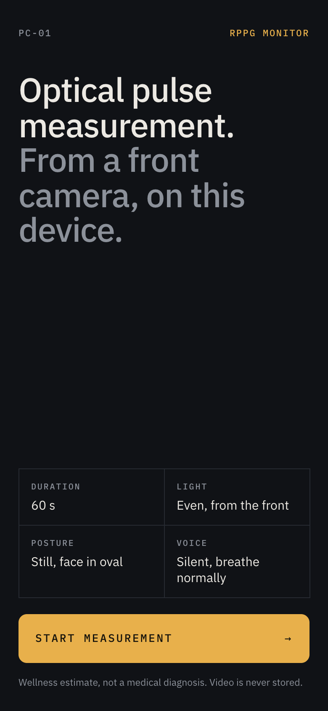

# vitalcheck

Camera-based pulse check in the browser. Look into the front camera for 60 seconds and the
app estimates your heart rate from tiny colour changes in your skin (remote
photoplethysmography, rPPG). An experimental blood-pressure estimate is included.

**Live app:** https://hiep-vitalcheck.vercel.app

<p align="center">
  
</p>

> Wellness estimate only. This is not a medical device and must not be used for diagnosis
> or treatment decisions. The blood-pressure value in particular is unvalidated.

## How it works

Everything runs on the device. Video frames are never uploaded or stored.

1. **Face tracking.** MediaPipe Face Landmarker finds the forehead and both cheeks. They are
   split into 16 small patches (forehead 4x2, each cheek 2x2).
2. **Skin colour per frame.** Each patch keeps only skin-coloured pixels (YCbCr test) and
   reports its mean red, green and blue. Patches that are too dark, too bright or flickering
   get less weight.
3. **Pulse signal.** Samples are resampled onto a uniform time grid and combined with the
   POS algorithm (Plane-Orthogonal-to-Skin, Wang et al. 2017), which removes most of the
   effect of light and motion.
4. **Heart rate.** A zero-phase Butterworth band-pass keeps 0.7-3.5 Hz (42-210 BPM). A
   Hann-windowed spectrum finds the strongest rhythm: BPM = peak frequency x 60. The power at
   that frequency and its harmonics versus the rest of the band gives the signal quality.
5. **Per-patch fusion.** POS also runs on each patch. Patches are aligned, weighted by their
   own signal quality and combined when that beats the whole-face signal.

The scan has a 2-second settle phase, then 60 seconds of measurement. Losing the face for
more than 1.5 seconds restarts it. During the scan the face oval paces breathing, 4 s in and
6 s out. Slow paced breathing can make the heart rate swing a little within each breath.

## Blood pressure (experimental)

Camera rPPG cannot measure absolute blood pressure reliably. The app derives pulse-shape
features and turns them into an estimate:

- Beats are cut foot to foot, time-normalized to the beat interval and combined into a
  median template. Beats that correlate below 0.8 with it are dropped.
- Features: heart rate, systolic rise time and width at half amplitude, both as fractions
  of the beat interval.
- **Uncalibrated:** hand-set coefficients (not fitted to data) map the features to SYS/DIA.
  Results outside the model's range are withheld, not clamped.
- **Calibrated:** enter one cuff reading taken with a scan. It is stored in `localStorage`.
  Later scans show that reading plus the model's estimated change. Large changes are
  withheld and ask for recalibration.

Neither mode has been validated against real measurements.

## Heart rate variability and breathing (experimental)

The app measures heart rate variability (HRV) from the beat feet of the whole-face pulse
signal. The face oval paces breathing at 6 per minute for the whole scan. So HRV is measured
during guided breathing and is not comparable with resting values.

- **Gates:** signal quality of at least 6 dB and a measured frame rate of at least 25 fps.
  Below 25 fps, foot timing error is larger than the beat-to-beat change.
- **Clean beats:** a beat interval (IBI) is clean when it is within 20% of the median of the
  11 IBIs around it. HRV needs at least 40 clean IBIs, and at least 80% of all IBIs must be
  clean.
- **RMSSD:** root mean square of the differences between neighbouring clean IBIs. Pairs with
  an unclean IBI are skipped.
- **SDNN:** standard deviation of all clean IBIs.
- **Range:** RMSSD above 200 ms or SDNN above 250 ms is withheld, not clamped.
- **Breathing rate:** the strongest peak of the IBI series spectrum between 3 and 30 breaths
  per minute. It only checks the guide: the user followed it when the rate is within 1 per
  minute of 6. It is not a natural breathing rate.

HRV and the breathing rate have not been validated against real measurements.

## Run locally

Requires Node.js 22.12 or newer.

```sh
npm install
npm run dev
```

Open http://localhost:5173. The first run copies the MediaPipe WASM runtime and downloads
the face model into `public/`. The camera only works over HTTPS or on `localhost`.

- `?debug=1` shows live diagnostics (frame rate, brightness, motion, sample count).
- `?track=0` uses fixed regions inside the oval instead of face tracking.

## Checks

```sh
npm run typecheck
npm test
npm run build
```

Tests use synthetic signals with known heart rate and pulse shape, including noise,
irregular frame timing, artefact beats and inverted polarity. They verify the signal
processing, not accuracy on real people.

## Project layout

| Path | Role |
| --- | --- |
| `src/dsp.ts` | Resampling, POS, filters, spectrum, heart rate |
| `src/sampler.ts` | Face regions, skin sampling per frame |
| `src/bp.ts` | Pulse shape and blood-pressure estimate |
| `src/hrv.ts` | HRV (RMSSD, SDNN) and paced breathing check |
| `src/calibration.ts` | Cuff calibration storage |

## Credits

- The processing pipeline follows the approach observed in the public app
  [vitalcheck.waaaa.co](https://vitalcheck.waaaa.co/), reimplemented from scratch.
- POS: W. Wang, A. C. den Brinker, S. Stuijk, G. de Haan, "Algorithmic Principles of
  Remote PPG", IEEE TBME 2017.
- Face tracking: [MediaPipe Tasks Vision](https://ai.google.dev/edge/mediapipe/solutions/vision/face_landmarker).
